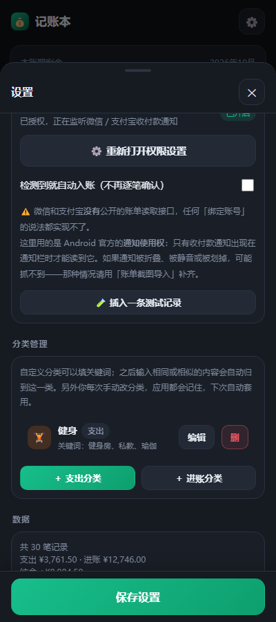
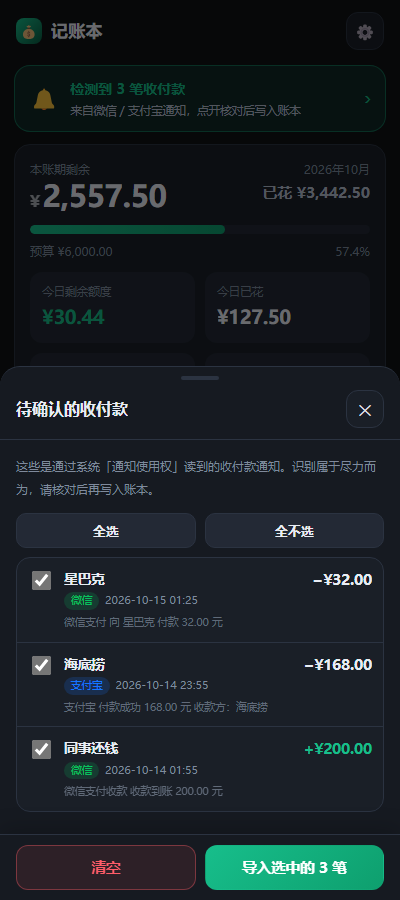
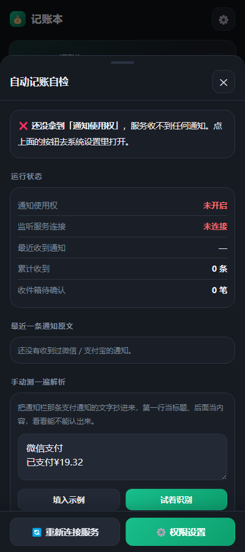
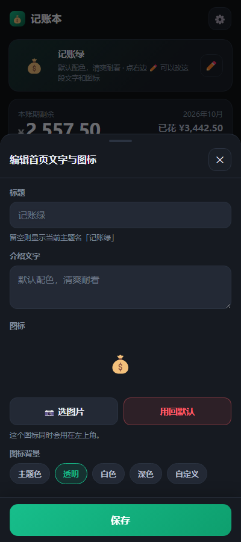
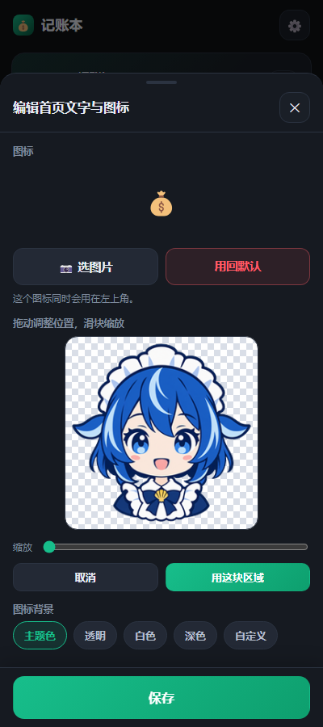
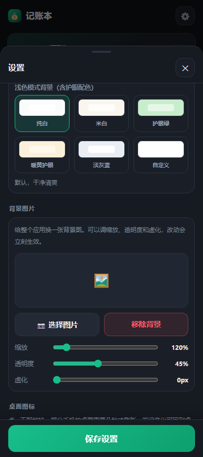
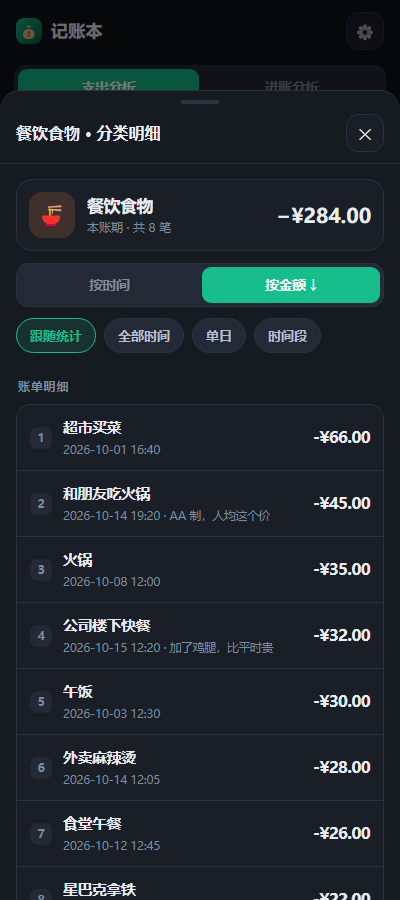
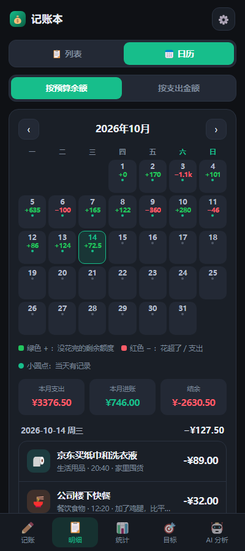
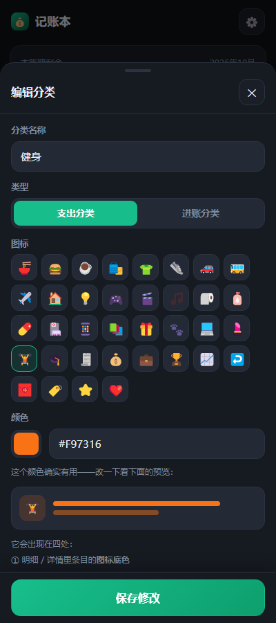

# 大肥鱼记账本 · LedgerBook for Android

一个可以直接装到安卓手机上的记账应用。**已编译好的安装包在 [`dist/LedgerBook-v1.6.0.apk`](dist/LedgerBook-v1.6.0.apk)**。

- 应用名：**大肥鱼记账本**
- 包名：`com.ledgerbook.app`
- 版本：1.6.0（versionCode 7）
- 系统要求：**Android 7.0（API 24）及以上**
- 安装包大小：约 3.0 MB
- 签名：自签名证书（v2 + v3 方案），可直接侧载安装

---

## 一、安装方法

1. 把 `dist/LedgerBook-v1.6.0.apk` 通过微信 / QQ / 数据线 / 网盘传到手机。
2. 在手机上点击这个文件。
3. 系统会提示「未知来源应用」，按提示允许安装即可（不同路径略有差异：
   设置 → 安全 → 安装未知应用 → 允许对应的文件管理器或浏览器）。
4. 安装完成后，桌面会出现一只 Q 版鲸鱼娘图标，名字叫「记账本」。

> 因为是自签名证书，部分手机的「应用商店安全检测」会提示风险，选择继续安装即可。

### 升级时千万不要卸载

账目数据存在应用私有目录里，**卸载会把所有记录一起删掉**，而且删了就找不回来。

直接下载新版 APK **覆盖安装**即可，数据会保留。覆盖安装能成功的前提是三条同时满足：

| 条件 | 当前值 |
|---|---|
| 包名一致 | `com.ledgerbook.app` |
| **签名证书一致** | SHA-256 `b5d4497831f47596cc117630a9a76b82dc5bdc5127a730f311063f4053ec7064` |
| `versionCode` 比已装的大 | 1.7.0 = 8 |

签名证书由根目录的 `ledger.keystore` 决定。**这个文件一旦丢失，
以后发的所有版本都无法覆盖安装，用户只能卸载重装并丢掉全部数据。**
所以它已加入 `.gitignore`，请自行离线备份。

> 唯一的例外：从 1.0.0 升到 1.1.0 那一次换过图标组件结构，需要卸载重装。
> 之后的版本都保持同一签名，覆盖安装即可。

### 想收到更新提醒

见「十六、给已安装用户推送更新」一节。

---

## 二、功能对照

### 基础功能

| 需求 | 实现情况 | 位置 |
|---|---|---|
| 记录花费项目和数额 | ✅ 支出表单常驻首页 | **记账** |
| 设定每月 / 每日计划额度 | ✅ 两者都可设 | **设置 → 预算额度** |
| 显示当日（按月平均）剩余额度 | ✅ 首页顶部大卡片 | **记账** |
| 省钱目标（可加图片、文字） | ✅ 图片支持拖拽缩放裁剪 | **目标** |
| 每笔花费可加备注备忘录 | ✅ 表单里有备注输入框 | **记账 / 明细** |
| 花费自动归档识别分类 | ✅ 关键词加权 + 学习规则 | 自动 |
| 时间范围内的花销总结 | ✅ 今日/本周/本账期/今年/全部/自定义 | **统计** |
| 累计花销分类 + 饼图 + 柱状图 | ✅ 环形图 / 柱状图 / 趋势折线 | **统计** |
| 生成 `【时间】\|【分类】\|【内容】\|【金额】` 文本 | ✅ 带正负号区分收支 | **明细 → 生成文本记录** |
| 接入大模型 API 做花费分析 | ✅ 支持流式输出 | **AI 分析** |

### v1.1 新增

| 需求 | 实现情况 | 位置 |
|---|---|---|
| 自定义主题颜色 | ✅ 8 套预设 + 取色器 + 色号手填 | **设置 → 主题配色** |
| 两套鲸鱼娘主题（Q版 / 成熟版） | ✅ 专属配色 + 立绘 + 顶栏吉祥物 | **设置 → 主题配色** |
| 应用图标改为 Q 版鲸鱼娘表情包 | ✅ 默认就是鲸鱼娘 | 桌面 |
| 从设置自选表情包自定义图标 | ✅ 6 款图标随时切换，桌面立即生效 | **设置 → 桌面图标** |
| 截图识别微信 / 支付宝账单 | ✅ 长图也行，走视觉大模型；另有纯本地文本解析 | **记账 → 从账单导入** |
| 日历表式每天 +/− 余额 | ✅ 月历，每天显示金额，可点开当日明细 | **明细 → 日历** |
| 配色规则可设：没花完绿+ / 花超红− | ✅ 「按预算余额」模式 | **明细 → 日历**／**设置** |
| 也可设置成花了就是红色− | ✅ 「按支出金额」模式 | 同上 |
| 进账选项 | ✅ 和支出一样直接展开 | **记账** |
| 进账可像花销一样查看统计 | ✅ 统计页可切「进账分析」 | **统计 / 明细** |
| 分类可自定义 | ✅ 可加支出/进账分类，能设关键词、图标、颜色 | **设置 → 分类管理** |
| 下次输入相同/相似项目自动归类 | ✅ 手动改一次分类就记住 | 自动 |

### v1.2 新增

| 需求 | 实现情况 | 位置 |
|---|---|---|
| 检测微信 / 支付宝收付款并自动记账 | ✅ 走 Android 官方「通知使用权」 | **设置 → 自动记账** |
| 明细快捷批量删除 | ✅ 多选 + 全选 + 底部固定操作条 | **明细 → 批量删除** |
| 浅色主题可自定义背景色 | ✅ 6 种方案 + 取色器 | **设置 → 主题配色** |
| 增加护眼 | ✅ 「护眼绿」与「暖黄护眼」两套低蓝光底色 | 同上 |
| 保存设置按钮固定在底部 | ✅ 不用滑到底 | **设置**（底部常驻） |

### v1.3 新增

| 需求 | 实现情况 | 位置 |
|---|---|---|
| 首页进账不再需要单独点开 | ✅ 进账表单直接展开 | **记账** |
| 首页顶部介绍改为可编辑文字 | ✅ 标题、介绍文字都能改 | **记账 → 欢迎条 ✏️** |
| 可自己改图标，同时改左上角大图标 | ✅ 一处设置，两处生效 | 同上 |
| 从设置更改桌面图标 | ✅ 支持 jpg/png/webp，背景可换色、可透明 | **欢迎条 ✏️ → 添加到桌面** |

### v1.4 新增

| 需求 | 实现情况 | 位置 |
|---|---|---|
| 统计里点分类看详细账单 | ✅ 点图例或排行里的分类名/图标即可下钻 | **统计 → 分类明细** |
| 可按时间 / 按金额排名 | ✅ 再点一次切换升/降序，按金额时带名次 | 同上 |
| 可筛选时间点 / 时间段 | ✅ 跟随统计 / 全部时间 / 单日 / 任意时间段 | 同上 |
| 改图标时可拖拽缩放选区 | ✅ 拖动定位 + 滑块缩放，所见即所得 | **欢迎条 ✏️ → 选图片** |
| 设置里移除自定义桌面图标 | ✅ 已移除，图标统一在欢迎条里改 | — |
| 首页介绍不再提示可修改 | ✅ 只保留右边的 ✏️ 图标 | **记账** |

### v1.5 新增

| 需求 | 实现情况 | 位置 |
|---|---|---|
| 截图识别把年份填成 2025 | ✅ 已修：让模型报告年份是否明确，缺年份时拉回最近的一年 | 自动 |
| 目标图片也能缩放截取 | ✅ 目标封面按 16:9 裁剪，可拖动缩放 | **目标 → 选图片** |
| 收到微信支付通知没有自动记账 | ✅ 加了「自动记账自检」定位断在哪一步 | **设置 → 自动记账自检** |
| 截图识别想用免费的视觉模型 | ✅ 加了豆包等 5 家有免费额度的预设，以及 Ollama 本地 | **设置 → 大模型接口** |
| 可自定义背景图片、缩放、透明度 | ✅ 另外还能调虚化，卡片会自动半透明 | **设置 → 背景图片** |

### v1.6 新增

| 需求 | 实现情况 | 位置 |
|---|---|---|
| 软件名改为「大肥鱼记账本」 | ✅ 桌面名称、顶栏、标题全部改掉 | 全局 |
| 背景图 / 图标图可拖拽缩放截取 | ✅ 三种裁剪预设：图标正方形、目标封面 16:9、背景竖版 9:16 | 选图片后自动出现 |
| Q版 / 成熟版主题增加默认背景 | ✅ 正面单人立绘，竖版 9:16，切主题自动生效 | 自动 |
| 待确认收付款可点击修改 | ✅ 内容、金额、类型、分类、日期时间、备注都能改 | **设置 → 自动记账 → 待确认** |
| AI 增加清空全部对话记忆 | ✅ 一点清空历史 + 输入 + 正在进行的请求 | **AI 分析** |
| AI 回答更简洁、不要 `**加粗**` | ✅ 提示词要求简洁，渲染层再兜一层剥掉 Markdown 记号 | 自动 |
| 提问后输入框残留文字 | ✅ 已修：发出后立即清空输入框 | **AI 分析** |
| 新增透明背景表情包图标 | ✅ 第 7 款桌面图标，棋盘格预览 | **设置 → 桌面图标** |
| 新增以表情包为封面的主题 | ✅ 「大肥鱼表情包」，用 DeepSeek 蓝 | **设置 → 主题配色** |
| 颜色预览文案改为「颜色图标预览」 | ✅ | **分类管理 → 编辑分类** |

---

## 三、大模型 API 配置

进入 **AI 分析 → 配置**（或右上角 ⚙️ → 大模型接口）：

| 字段 | 说明 |
|---|---|
| **服务商预设** | 选一个会自动填好地址和模型名 |
| **API 地址** | 根地址或完整地址都行，会自动补全 `/v1/chat/completions` |
| **API Key** | 服务商控制台申请的密钥，形如 `sk-...` |
| **模型名称** | 例如 `deepseek-chat` |
| **视觉模型** | 识别账单截图用，例如 `glm-4v-flash` / `qwen-vl-max`；不填则沿用上面的模型 |

内置预设：DeepSeek、OpenAI、Kimi、通义千问、智谱 GLM、硅基流动、OpenRouter、
**豆包（火山方舟）**，以及本地 Ollama / LM Studio / One-API。
只要兼容 OpenAI 的 `/v1/chat/completions` 就能用。

> 应用已允许明文 HTTP，可以直接连局域网里的 `http://192.168.x.x:11434`。

### 账单截图识别想少花钱 / 不花钱

截图识别必须用**能读图的模型**，纯文本模型（如 `deepseek-chat`）做不了。
下面这些是有免费额度、或完全免费的选择：

| 服务商 | 视觉模型 | 说明 |
|---|---|---|
| **智谱 GLM** | `glm-4v-flash` | 目前**免费**，截图识别够用，推荐先试这个 |
| **硅基流动** | `Qwen/Qwen2-VL-7B-Instruct` | 注册送额度，部分视觉模型免费 |
| **通义千问** | `qwen-vl-max` | 新用户有免费额度，识图效果好 |
| **豆包（火山方舟）** | `doubao-1-5-vision-pro-32k` | 需先在火山方舟控制台开通并创建接入点；模型名也可以直接填接入点 ID（`ep-xxxx`） |
| **Ollama 本地** | `qwen2.5vl:7b` | **完全免费、不需要 key**，在电脑上跑，手机同网络访问 |

在「服务商预设」里选对应项，视觉模型会自动填好。

### 能不能做到「完全不要 key」？

说实话：**截图 OCR 做不到零配置**。

- 真正不要 key 的离线 OCR 需要用 Google 的 ML Kit（或 Tesseract）。
  ML Kit 依赖 Gradle 做依赖解析和资源合并，而这个项目是**手工用
  aapt2 + javac + d8 打包**的，没有 Gradle；Tesseract 的简体中文模型
  要 40MB 左右，塞进 WebView 里跑也不现实。这两条路都没有走。
- **不要 key 的替代方案**是「**粘贴账单文本**」导入：微信 / 支付宝都能导出
  账单文本，这条路径是纯本地正则解析，完全不需要任何 API。
  位置在 **记账 → 从账单导入 → 粘贴账单文本**。
- 想要「免费 + 能读图」，用上表里的免费额度方案，或者 Ollama 本地部署。

这是个取舍：与其塞一个 40MB 的离线 OCR 进来还不稳定，不如把「免费额度的视觉模型」
和「纯本地的文本导入」两条路都做通。

### 测试连接报错怎么办

点「🔌 测试连接」失败时会弹出**诊断面板**（不是一闪而过的提示）：

- **401 / Authentication Fails** → Key 无效。去服务商控制台重新复制一个，
  注意不要把 `Bearer ` 或引号一起复制进去。应用会自动去掉首尾空格。
- **404** → 地址不对，检查是不是漏了 `/v1`，或服务商不是这个路径。
- **402 / 余额不足** → 去充值。
- **超时 / 连不上** → 检查手机网络；用本地模型时确认手机和电脑在同一 WiFi。

---

## 四、自动记账与账单导入

让记录自动进账本有两条路：**通知监听**（自动、实时）和**账单导入**（手动、可补漏）。

### 4.1 自动记账（监听微信 / 支付宝收付款）

入口：**设置 → 自动记账**。



**先说清楚原理**：微信和支付宝都**没有**提供读取账单的公开接口，
任何「绑定账号自动同步」的说法都做不到。这里用的是 Android 官方的
**通知使用权**（`NotificationListenerService`）——只有收付款通知出现在
通知栏时，才能读到它。

开启步骤：

1. 设置 → 自动记账 → **🔓 去开启通知使用权**
2. 在系统列表里找到「记账本」，把开关打开
3. 回到应用，状态会显示「已开启」

开启后，微信 / 支付宝的收付款通知会被实时解析：



- 默认是**待确认模式**：识别到的记录先攒在「待确认」里，你核对勾选后才写入账本
- 打开「检测到就自动入账」后，识别到会直接记账并提示
- 「🧪 插入一条测试记录」可以在收不到真实通知时验证整条链路

**点某一条可以直接改它**：内容、金额、支出/进账、分类、日期时间、备注都能改，
改过会标一个「已改」的小标签。识别不准的时候不用先导入再返工。


**解析规则**（`PayParser`）同时命中「金额」与「收/付款」关键词才认定是一笔交易，
以此过滤活动推广。两个容易误判的情况已专门处理：

| 通知文本 | 判定 |
|---|---|
| `微信支付收款 到账 88.88 元` | 进账（虽然含「支付」） |
| `付款成功 25.00 元 收款方：某某便利店` | 支出（虽然含「收款」） |

**可能的漏抓**：通知被折叠成一行、被静音、或被你不小心划掉时，可能收不到。
这种情况请用下面的账单导入补上。

#### 没自动记账？先用自检定位



**设置 → 自动记账 → 🩺 自动记账自检**会把链路拆成几段分别显示，
一眼就能看出断在哪：

| 现象 | 说明 | 怎么办 |
|---|---|---|
| 通知使用权「未开启」 | 还没授权 | 点「权限设置」去系统里打开 |
| 服务「未连接」 | 授权了，但被系统回收了 | 点「重新连接服务」；还不行就去系统里放开自启动 / 后台运行 / 电池优化 |
| 「最近收到通知」一直是「—」 | 权限和连接都正常，但一条通知都没到 | 去付一笔 0.01 元试试；一直不刷新就是厂商 ROM 拦了通知转发 |
| 收到了但「没能识别」 | 前端链路没问题，是解析规则没覆盖这条文案 | 面板里有原文，复制出来反馈 |
| 全部正常 | 整条链路是通的 | 检查记录是不是躺在「待确认」里没导入 |

面板里还有一块「手动测一遍解析」：把通知栏那条文字抄进去，
第一行当标题、后面当内容，点「试着识别」就能当场验证。

> 实测「微信支付 / 已支付¥19.32」这种文案是**能正确识别**的（已加进自动化测试）。
> 所以如果自检里显示「收到了但没能识别」，那才是需要改解析规则的情况。

### 4.2 账单导入

**记账 → 从账单截图 / 文本导入**，两种方式：

| 方式 | 需要 API Key | 说明 |
|---|---|---|
| **粘贴账单文本** | ❌ 不需要 | 纯本地正则解析，离线可用 |
| **账单截图识别** | ✅ 需要视觉模型 | 长图也能识别，走大模型 |

导入前一定会给出预览，逐条勾选后才写入账本。

#### 日期识别的年份修正

模型有时候会把示例里的年份照抄下来（比如账单上只有「10-15」，
它却输出 `2025-10-15`）。现在做了两件事：

1. **提示词里写明今天的日期**，并要求模型额外返回一个 `yearKnown` 字段，
   表示「账单上是否明确写了年份」。
2. **识别到之后再做一次校正**：
   - `yearKnown` 为假 → 保留月日，把年份换成离今天最近的那一年
   - `yearKnown` 缺失 → 只在偏差落在 120~400 天时才校正（这个区间是缺年份
     时最可能出现的偏差，不会误伤真实的历史账单）
   - 完全没识别到日期 → 用系统当前日期

导入时如果有记录被修正过，状态栏会提示修正了几条，方便你核对。

---

## 五、主题与图标

### 主题配色

9 套预设：记账绿（默认）、DeepSeek 蓝、樱花粉、星河紫、暖阳橙、
鲸鱼娘·Q版、鲸鱼娘·成熟版、**大肥鱼表情包**、自定义颜色。

其中三个角色主题会**自动带一张默认背景**：

| 主题 | 默认背景 |
|---|---|
| 鲸鱼娘 · Q版 | 竖版 Q 版正面立绘 |
| 鲸鱼娘 · 成熟版 | 竖版成熟版正面立绘 |
| 大肥鱼表情包 | 无（用 DeepSeek 蓝纯色） |

默认背景会跟着主题自动切换；你自己选了背景图就会覆盖它，
点「移除背景」可以关掉，关掉之后设置里会出现「恢复主题默认背景」。

浅色模式另有 6 种背景：纯白、米白、**护眼绿**、**暖黄护眼**、淡灰蓝、自定义。
选自定义时卡片和描边会按底色自动推导，保证层次分明。

### 桌面图标

7 款可切换，点一下即生效：

| 图标 | 说明 |
|---|---|
| 鲸鱼娘 Q版·蓝 | 默认 |
| 鲸鱼娘 Q版·粉 | |
| 鲸鱼娘 Q版·浅色 | |
| 鲸鱼娘 Q版·大头 | |
| 鲸鱼娘 成熟版 | |
| **大肥鱼表情包** | **透明背景**，用棋盘格预览 |
| 经典钱袋 | 不用角色主题时 |

**实现方式**：清单里声明了 6 个 `activity-alias`，每个指向不同的 `@mipmap`，
通过 `PackageManager.setComponentEnabledSetting` 切换启用项。
切换后部分手机的桌面需要几秒才刷新，如果没变化，回到桌面等一会儿即可。

### 首页欢迎条（文字与图标都在这里改）



首页最顶部那条点右边的 **✏️** 就能改：

- **标题**：留空则显示当前主题名
- **介绍文字**：随便写
- **图标**：可以用自己的图片，也可以选背景色或透明
- 改完的图标同时会出现在**左上角**

> 欢迎条本身**不再提示**「可以修改」，免得啰嗦——右边那个 ✏️ 就是入口。

### 选图片时可以拖拽缩放裁剪



选了图片之后会出现一个裁剪框：

- **拖动**调整位置
- **滑块**缩放（100%~400%，以选区中心为锚点）
- 棋盘格底能看出哪里是透明的
- 点「用这块区域」确定，所见即所得

两种预设：**图标是正方形**（输出 512×512），**目标封面是 16:9**（输出 960×540），
**应用背景是竖版 9:16**（输出 1080×1920），都保留透明通道。

### 用你自己的图片做图标

- 支持 **jpg / png / webp** 等常见格式
- 背景可选：**主题色 / 透明 / 白色 / 深色 / 自定义颜色**
- 编辑器里还有「📌 把这个图标添加到桌面」

**这里必须说清楚一件事**：安卓**不允许**应用在运行时替换自己的启动器图标——
图标是编译进安装包的资源，任何应用都改不了（这不是实现偷懒，是系统限制）。
系统唯一官方支持的做法是**把一枚快捷方式固定到桌面**：

- 它和普通应用图标一样出现在桌面上，点一下同样打开记账本
- 可以用你自己的图片，支持透明背景

清单里那 6 款内置图标则是真的在切换应用自身的图标（因为它们是编译期就存在的资源）。

### 自定义背景图片



**设置 → 背景图片**：

- 选一张图作为整个应用的背景
- **缩放** 100%~300%
- **透明度** 5%~100%
- **虚化** 0~24px
- 三个滑块都是**拖动即时生效**，不用点保存

有背景图时，卡片、顶栏和底栏会自动变成半透明并加一层背景模糊，
否则背景图会被卡片完全挡住。

---

## 六、统计、日历与分类下钻

### 统计

- 支出分析 / 进账分析可切换
- 时间范围：今日、本周、本账期、今年、全部、自定义
- 四种视图：**分类占比**（环形图）、**按日**（柱状图）、**按月**、**趋势**（折线）
- 核心指标：合计、笔数、日均、结余

### 点分类看详细账单



统计页里的**环形图图例**和**分类排行**都能点，点任意一个分类名或图标就进入该分类的明细：

- 顶部是这个分类的图标、名称、金额合计和笔数
- **按时间** / **按金额** 两种排名；再点一次同一个按钮可切换升序 / 降序
- 按金额排名时会带 **1、2、3…** 的名次
- 时间筛选四种口径：
  - **跟随统计**（默认，跟上面选的范围一致）
  - **全部时间**
  - **单日**（选某一天）
  - **时间段**（任意起止日期）
- 每条都能点进去看 / 改完整记录

### 日历视图



- 月历，每天显示一个 `+/-` 数值，颜色区分正负
- 点某一天，下方直接展开当天的明细
- 底部是本月支出 / 进账 / 结余汇总
- 顶部可切换两种口径（也可以在设置里改默认值）

---

## 七、数据与备份

- 记录保存在应用私有目录 `filesDir/ledger/db.json`，图片在 `filesDir/ledger/images/`。
- **设置 → 数据 → 备份数据**：生成 JSON，可复制或分享出去保存。
- **恢复备份**：把 JSON 粘回去即可。
- 每 15 次写入自动留一份 `db.bak.json` 兜底。
- 从旧版本升级会自动迁移旧数据（旧记录一律视为支出）。

> 卸载应用会一并删除数据，重要数据请先「备份数据」。

---

## 八、从源码重新构建

### 需要准备

| 依赖 | 说明 |
|---|---|
| JDK | 11 或更高（开发时用的是 JDK 20） |
| Android SDK Build-Tools | 提供 `aapt2`、`d8`、`zipalign`、`apksigner` |
| Android Platform | 提供编译用的 `android.jar` |
| Node.js | 只用于打包 APK 与生成图标 |
| Python + Pillow | 只在重新生成图标素材时需要 |

### 一条命令

```powershell
powershell -ExecutionPolicy Bypass -File .\build.ps1 -Toolchain "G:\FeverApps\android-build" -Clean
```

> **注意**：仓库里**不包含** `ledger.keystore`（签名私钥），它已在 `.gitignore` 里。
> 从仓库克隆后第一次构建时，脚本会自己生成一个新的 keystore；
> 如果你想让自己构建的包能覆盖安装已有版本，需要把原来的 keystore 放回根目录。
> **永远不要把这个文件提交到公开仓库。**

脚本会依次完成：生成图标 → 编译资源 → 链接清单 → 编译 Java → 转 DEX →
注入网页资源与 dex → 对齐 → 签名 → 验证签名。产物在 `dist\LedgerBook-v1.7.0.apk`。

常用参数：

| 参数 | 说明 |
|---|---|
| `-Toolchain <dir>` | Android 构建工具所在目录 |
| `-Clean` | 清理后全量重建 |
| `-SkipIcons` | 跳过图标生成（图标没改时能快一点） |
| `-VersionName` / `-VersionCode` | 覆盖版本号 |

### 为什么不用 Gradle

这是刻意的选择：整个项目是**手工调用构建工具链**打包的。
好处是没有任何构建系统依赖，一个 JDK + Build-Tools 就能出包；
代价是集成第三方库（尤其是带原生 `.so` 和资源的 AAR）非常麻烦——
这也是为什么**没有集成 ML Kit 做离线 OCR**。

---

## 九、工程结构

```
LedgerApp/
├── build.ps1                     一键构建脚本
├── README.md
├── android/
│   ├── AndroidManifest.xml       清单（含 6 个 activity-alias 与通知监听服务）
│   ├── res/                      图标、字符串、样式
│   ├── java/com/ledgerbook/app/
│   │   ├── MainActivity.java     WebView 容器 + 文件选择器
│   │   ├── JsBridge.java         存储 / 图片 / HTTP / 流式 / 剪贴板 / 图标 / 收付款 / 自检
│   │   ├── PayParser.java        微信 / 支付宝通知文本解析（纯 Java，可单测）
│   │   ├── PayStore.java         待确认收付款收件箱 + 运行状态
│   │   └── PayListenerService.java  通知监听服务
│   └── assets/www/               网页层（就是应用本体）
│       ├── index.html
│       ├── css/app.css
│       └── js/
│           ├── theme.js          主题与配色
│           ├── classify.js       分类识别
│           ├── charts.js         Canvas 图表
│           ├── store.js          数据层与预算计算
│           ├── calendar.js       日历视图
│           ├── ai.js             大模型接口
│           ├── import.js         账单导入与截图识别
│           └── app.js            界面与交互
├── assets-src/                   图标与立绘的原始素材
├── dist/
│   └── LedgerBook-v1.6.0.apk     最终安装包
├── tools/
│   ├── apkpack.js                把网页资源与 dex 注入 APK（并修正路径分隔符）
│   ├── make-icons.js             生成内置图标变体
│   └── whale_assets.py           从素材生成立绘与网页图
└── test/
    ├── harness.html              424 项前端断言
    ├── run.js                    jsdom 测试驱动
    ├── PayParserTest.java        45 项解析器断言
    ├── run-java.ps1              编译并运行上面的 Java 测试
    ├── shot.html                 截图专用页面（含演示数据）
    └── shots/                    各页面截图
```

---

## 十、实现要点（踩过的坑）

### 1. aapt2 在 Windows 上会写出反斜杠路径

`aapt2 link -A assets` 生成的条目名是 `assets\www\js\app.js`，
在设备上会**白屏**。所以构建脚本没有用 `-A`，而是自己写了个打包器
（`tools/apkpack.js`）把网页资源注入 APK，并把分隔符统一成正斜杠。

### 2. resources.arsc 必须保持 STORED

`resources.arsc` 需要 4 字节对齐且不能被压缩，
所以打包器是**直接复制原始压缩数据**，而不是重新压缩。
校验用 `zipalign -c -p -v 4`（参数顺序有讲究，`-p` 必须在 `-v` 前）。

### 3. 动态桌面图标

同一时刻必须**恰好启用一个** `activity-alias`，否则应用会从桌面消失。
`JsBridge.setLauncherIcon()` 会在一次循环里启用目标项、禁用其余项，
并使用 `DONT_KILL_APP` 避免切换时被杀掉进程。

### 4. 分类学习的分类解析顺序

学到的分类可能是**自定义分类**，不能只在内置分类表里查。
早期版本因为这个原因导致「学习不生效」，已修正并加了回归测试。

### 5. 通知监听服务必须「永不崩溃」

`NotificationListenerService` 的回调如果抛异常，会影响系统通知栏的稳定性。
因此 `onNotificationPosted` 整个包在 `try/catch (Throwable)` 里，
任何解析问题都只是丢掉这一条，绝不让服务挂掉。

另外，识别结果**不放在内存里**：通知可能在应用没打开时到达，
所以统一落盘到 `filesDir/ledger/pay-inbox.json`，应用下次打开时再读取确认。
运行状态（是否连上、最近收到什么）另存在 `pay-status.json`，供自检面板读取。

### 6. 重新识别会覆盖未保存的修改

表单里改了内容后点「重新识别」，如果直接按数据库旧值重绘面板，
用户的修改就被悄悄回滚了。正确做法是**先把表单落盘、再基于新内容识别**。
这个 bug 已修复，并加了回归断言。

### 7. 为什么自定义图标只能做成桌面快捷方式

`android:icon` 指向的是安装在 APK 里的资源，运行时无法替换——
这是 Android 的设计，不是实现上的取舍。想让桌面出现「自己的图片」，
唯一被系统支持的途径是 `ShortcutManager.requestPinShortcut()`
固定一枚带自定义 `Icon.createWithBitmap()` 的快捷方式。

### 8. 合成图标必须保留透明通道

canvas 导出时用的是 `toDataURL('image/png')`。
目标配图那条路径会铺白底、输出 JPEG，直接拿来用会把透明背景变成白底。

### 9. 用 PowerShell 改文本文件会把编码搞坏（真实踩过）

Windows PowerShell 5.1 默认按 ANSI（简体中文系统是 GBK）读取没有 BOM 的
UTF-8 文件。用 `Get-Content` + `Set-Content` 做文本替换，会把中文写成乱码，
而且因为 GBK 是变长编码，**损坏不可逆**。

改动文本文件请用能显式指定 UTF-8 的方式。这个坑是真实踩过的：
一次 README 的批量替换导致 647 个字符丢失，最后只能整份重写。

---

## 十一、自动化测试

测试分两部分，共 **469 项断言**。

### 1) 前端（jsdom）

用 [jsdom](https://github.com/jsdom/jsdom) 真实加载应用并执行断言，覆盖：
分类识别、自定义分类与学习、相似度、文本格式、预算计算、进账、日历、
统计聚合、图表绘制、界面渲染、弹层交互、目标存取、记账表单、主题系统、
接口地址解析、账单文本解析、视觉 JSON 处理、备份恢复、批量删除、
浅色背景与护眼配色、桌面图标切换、自动记账收件箱流程、
**分类下钻与排序筛选**、**图标裁剪**、**年份修正**、**背景图片**、**自动记账自检**。

测试里注入了一套**模拟的安卓原生桥**，所以 `HAS_NATIVE` 分支（原生文件存储、
图片、图标切换、收付款收件箱、解析器）都能被真正测到，而不是只测浏览器回退路径。

```powershell
cd test
npm install            # 首次运行前安装 jsdom
node run.js
```

当前结果：**424 项全部通过**。

### 2) 原生解析器（纯 Java）

`PayParser` 不引用任何 Android 类，可以用普通 `javac` 编译直接跑，不需要模拟器：

```powershell
powershell -ExecutionPolicy Bypass -File .\test\run-java.ps1
```

当前结果：**45 项全部通过**（覆盖微信 / 支付宝各类通知文案、误判场景、
金额格式、来源识别与去重特征，含实测通知「微信支付 / 已支付¥19.32」）。

界面截图（`test/shots/`）由 Edge 无头模式渲染生成，用于视觉回归检查。

---

## 十二、素材与授权

- 鲸鱼娘立绘与图标素材来自 [TreapGoGo/deepseek-whale-girl](https://github.com/TreapGoGo/deepseek-whale-girl)，
  授权为 **MIT License（Copyright © 2026 TreapGoGo）**。
- 该角色是同人创作，与 DeepSeek 官方无隶属关系。
- 署名信息同时出现在应用内的「关于」与本节。

---

## 十三、常见问题

### 自定义分类里的「颜色」有什么用？改了有区别吗？

**有区别。** 这个颜色会出现在四个地方：

1. **明细 / 详情**里该分类条目的图标底色
2. **统计页环形图**中该分类的扇区颜色
3. 环形图**图例色块**与**分类排行条**
4. **分类管理列表**里的图标底色

分类编辑器里有一段实时预览，改颜色时能立刻看到效果：



### 改了内容后点「按内容重新自动识别」，改动会丢？

这是 1.1.0 的一个 bug，**1.2.0 已修复**。

原因：点重新识别时，面板会按数据库里的旧值重绘，而表单里还没保存的修改被丢掉了。
现在会先把表单内容落盘，再基于改过之后的内容做识别，所以改动不会丢。

### 截图识别出来的日期年份不对

已在 1.5.0 修复，详见「4.2 账单导入 → 日期识别的年份修正」。

### 为什么截图识别要填 API Key，不能完全免费吗

可以免费，但仍需要一个（免费的）密钥。真正「零配置离线 OCR」需要 ML Kit，
这个项目没有 Gradle，集成不可靠。详见「三、大模型 API 配置」里那一节。

---

## 十四、已知限制

- **自定义图标是「桌面快捷方式」而不是替换应用图标**：这是安卓的系统限制，
  应用无法在运行时更换自己的启动器图标。部分桌面不支持固定快捷方式（此时按钮会禁用），
  另外带透明背景的图标在个别桌面上可能被自动垫上白色底——这属于桌面行为，应用无法控制。
- **自动记账的能力边界**：微信和支付宝没有公开账单接口，只能靠系统通知。
  通知被折叠、静音或划掉时可能漏抓；厂商 ROM 也可能拦截通知转发。
  所以它是「省事」而不是「万无一失」，重要账目请用「账单截图导入」核一遍。
- **自动分类是关键词 + 学习规则，不是模型。** 生僻描述会归到「其他」，
  此时点选一次分类即可让它记住。
- **AI 分析需要自备 API Key**，应用不提供也不需要任何账号。
- **截图识别需要能读图的模型。** 纯文本模型看不了图；没有视觉模型时可以改用
  「粘贴账单文本」，那条路完全不需要 key。
- **本地文本解析是尽力而为的正则**，不同版本导出的账单格式略有差异；
  好在导入前一定会给预览让你核对。
- **桌面图标切换**在部分手机上需要几秒或重启桌面才显示。
- **浅色自定义背景建议选浅色**。选深色时文字仍是深色，对比度会变差。
- **背景图片会占用一点内存**，选特别大的图可能会略卡。
- **流式输出依赖服务端支持 SSE**，不支持时把「流式输出」关掉即可。
- **推理模型**（如 DeepSeek-R1）在思考阶段界面会显示「思考中」，这是正常的。
- 应用未做多设备同步，数据只在本机。

---

## 十五、许可

本项目为个人自用项目，随意修改使用。第三方素材遵循其各自授权（见第十二节）。
各 AI 服务商的使用需遵守其各自条款。

---

## 十六、给已安装用户推送更新

### 先说结论：安卓不允许「推送」更新

侧载安装的应用**没有办法静默自动更新**。任何更新都必须经过：

```
应用发现新版本  →  提示用户  →  用户点击  →  下载 APK  →  系统安装确认弹窗  →  用户点「安装」
```

只有设备所有者（MDM）或系统应用能跳过最后那一步。所以「推送」能做的上限是
**帮你把「发现新版本 → 下载 → 拉起安装器」这几步自动化**，最后一下永远得用户点。

### 覆盖安装的三个前提

三者缺一，安装会失败并报 `INSTALL_FAILED_UPDATE_INCOMPATIBLE`，
用户只能卸载重装——**账目数据全部丢失**。

1. 包名相同 `com.ledgerbook.app`
2. **签名证书完全相同**（由 `ledger.keystore` 决定）
3. `versionCode` 大于已安装版本

所以 `ledger.keystore` 必须长期保存并离线备份，它已经加入 `.gitignore`。

### 三条可行路线

#### 路线 A：Obtainium（零开发，最省事）

[Obtainium](https://github.com/ImranR98/Obtainium) 是开源的安卓应用更新器，
可以直接盯 GitHub Releases 页面并提示安装。

用户操作：装上 Obtainium → 添加本仓库地址 → 之后后台自动检查更新。

**不需要改任何代码**，缺点是用户得多装一个 App。

#### 路线 B：应用内自带更新检查（体验最好，需要在应用里加代码）

流程：

1. 启动时（或点「检查更新」时）请求 GitHub Releases API
   `https://api.github.com/repos/<用户>/<仓库>/releases/latest`
2. 取 `tag_name` 与本地 `versionCode` 比较
3. 有新版本 → 首页显示横幅「发现新版本 v1.8.0」
4. 点击 → 下载 APK 到应用缓存目录
5. 用 `FileProvider` 拿到 content:// URI，
   发 `ACTION_VIEW` + `application/vnd.android.package-archive`
6. 系统安装器弹出，用户确认后覆盖安装（数据保留）

需要补的东西：

| 项 | 说明 |
|---|---|
| `REQUEST_INSTALL_PACKAGES` 权限 | Android 8.0+ 必须声明，且用户要在系统设置里允许「安装未知应用」 |
| `FileProvider` + `res/xml/file_paths.xml` | 把缓存目录的 APK 暴露给安装器（不能直接传 file:// ） |
| `JsBridge` 新增方法 | `checkUpdate()` / `downloadApk(url)` / `installApk(path)` |
| 设置页新增入口 | 「检查更新」按钮 + 当前版本号显示 |
| 启动时静默检查 | 一天最多查一次，失败不打扰用户 |

#### 路线 C：手动（最原始）

在 GitHub Releases 页面发布新版本，用户自己去下载覆盖安装。
不需要任何代码，但用户得自己留意有没有新版。

### 发版时的检查清单

每次发新版本前：

1. 改 `android/AndroidManifest.xml` 里的 `versionCode`（**必须递增**）和 `versionName`
2. 跑一次完整构建：`build.ps1 -Clean`
3. 确认用的是同一个 `ledger.keystore`（看构建日志里的签名指纹是否还是
   `b5d44978...7064`）
4. 在 GitHub 上打 tag（如 `v1.8.0`）并创建 Release，
   把 `dist/LedgerBook-v1.8.0.apk` 作为附件上传
5. Release 说明里写清楚这次改了什么

> **不要**在 Release 说明里让用户「先卸载旧版」——那会删掉他们所有账目。

### 关于数据安全

数据只存在手机本地的 `filesDir/ledger/`，没有云端同步。这意味着：

- 覆盖安装 → 数据保留 ✅
- 卸载重装 → 数据丢失 ❌
- 换手机 → 需要用「设置 → 数据 → 备份数据」导出 JSON，在新机上恢复

所以更新机制设计得越顺，用户越不容易误卸载。

